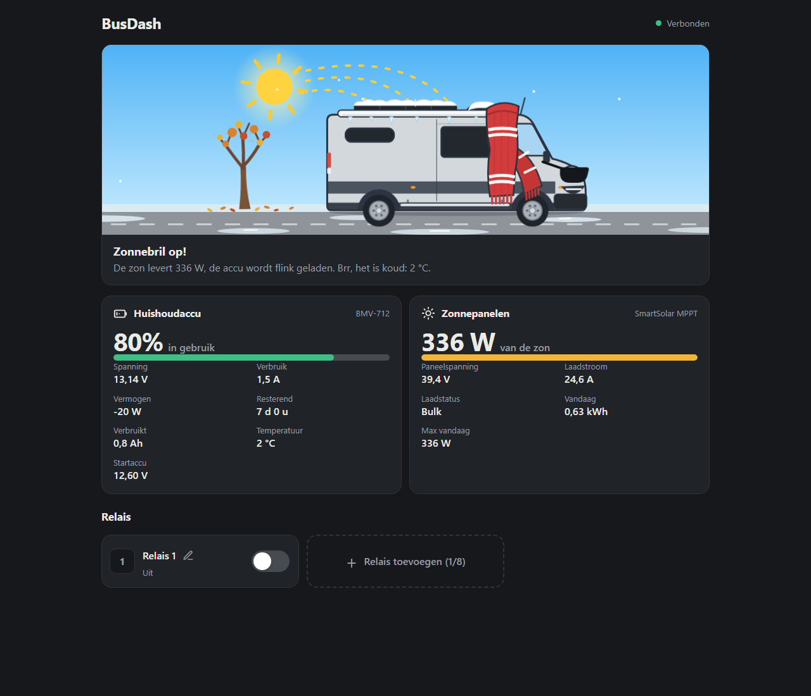
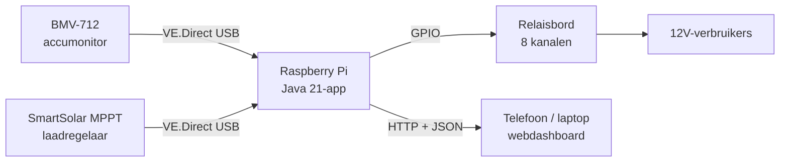

# BusDash edge

Een dashboard voor mijn camperbus (Mercedes Sprinter), draaiend op een Raspberry Pi in de bus.
Het leest de accumonitor en de zonnelaadregelaar van Victron uit, schakelt 12V-verbruikers via een
relaisbord en laat alles zien op één webpagina die op telefoon en computer werkt.



De cartoonbus laat in één oogopslag zien hoe het ervoor staat: **zonnebril op** als de panelen flink
leveren, **slapend** 's nachts en **wakker** als er weinig gebeurt. Zakt de temperatuur onder 3 °C,
dan krijgt hij **een sjaal om**, ligt er ijs op de weg en sneeuw op het dak. Het **boompje** ernaast
laat het seizoen zien: kaal in de winter, jong blad en bloesem in de lente, een volle kroon in de zomer
en vallend blad in de herfst.

Voor een demonstratie kun je seizoen en temperatuur in de adresbalk vastzetten, bijvoorbeeld
`http://localhost:8080/?seizoen=winter&temp=-2` (seizoenen: `winter`, `lente`, `zomer`, `herfst`).

## Wat het doet
- **Accu (Victron BMV-712):** laadpercentage, spanning, stroom, vermogen, resterende tijd, verbruikte Ah,
  temperatuur of startaccu.
- **Zon (Victron SmartSolar MPPT):** paneelvermogen en -spanning, laadstroom, laadstatus, opbrengst
  en hoogste vermogen vandaag.
- **Relais (Waveshare RPi Relay Board (B), 8 kanalen):** aan/uit vanaf de telefoon, met eigen namen.
  Begint met één relais, met **+** voeg je er tot acht toe.
- **Login** met gehashte wachtwoorden en blokkering bij te veel foute pogingen.

## Architectuur



| Package     | Verantwoordelijkheid |
|-------------|----------------------|
| `vedirect/` | VE.Direct-protocol: streaming parser met checksumcontrole, seriële bron met herverbinden |
| `battery/`  | BMV-712: `BatteryMonitor`-interface met een echte en een gesimuleerde implementatie |
| `solar/`    | SmartSolar MPPT: `SolarCharger`-interface met een echte en een gesimuleerde implementatie |
| `status/`   | Stemming van de bus (`MoodTracker`) |
| `relay/`    | `RelayBoard`-interface, Waveshare-aansturing via Pi4J/libgpiod, namen en zichtbaarheid |
| `web/`      | Webserver, JSON-API, login (`Auth`, `UserStore`, `PasswordHasher`) |

## Ontwerpkeuzes
- **Weinig afhankelijkheden.** De webserver is de `HttpServer` uit de JDK en de JSON wordt met de hand
  gemaakt. Alleen jSerialComm (seriële poort) en Pi4J (GPIO) zijn externe libraries. Het resultaat is
  één jar die op de Pi alleen een JRE nodig heeft.
- **Alle hardware achter een interface,** elk met een gesimuleerde variant. Met `--fake` draait de hele
  app op een laptop zonder Pi of Victron-apparatuur. Een gesimuleerde dag duurt drie minuten, zodat je
  alle stemmingen van de bus voorbij ziet komen, inclusief een koude nacht.
- **Robuust tegen de echte wereld.** De parser controleert de checksum van elk blok en gooit kapotte data
  weg. Valt een kabel weg, dan blijft de app opnieuw verbinden (wachttijd oplopend van 2 naar 30 s).
  Is een meting ouder dan 10 seconden, dan toont het dashboard "Geen actuele gegevens" in plaats van een
  oude waarde.
- **Hysterese in de stemming en de kou,** zodat de bus bij een voorbijtrekkend wolkje of rond de
  3 °C niet steeds wisselt.
- **Veilig standaardgedrag.** Wachtwoorden worden als PBKDF2-hash opgeslagen. De sessiecookie is
  `HttpOnly` en `SameSite=Strict` en wordt `Secure` achter HTTPS. Schrijvende API-aanroepen vereisen een
  eigen header tegen CSRF. Na 10 foute pogingen binnen 15 minuten wordt een adres 5 minuten geblokkeerd.
  Bij afsluiten gaan alle relais uit.
- **59 unittests** voor de parser, de BMV- en MPPT-logica, de stemming, de relais, de login en de
  webserver. Ze draaien zonder hardware.

## Zelf proberen
Vereist Java 21 en Maven.

```bash
mvn package
java -jar target/busdash-edge-0.1.0-SNAPSHOT.jar --dashboard --fake --no-login
```
Open daarna `http://localhost:8080/`. Alles is gesimuleerd; `--no-login` is alleen bedoeld voor lokaal
ontwikkelen. Tests draaien met `mvn test`.

## Installatie op de Raspberry Pi
Getest op een Raspberry Pi 3B+ met Debian 13 en OpenJDK 21.

1. Kopieer de jar naar de Pi en zet de gebruiker in de groepen `dialout` (seriële poorten) en `gpio`
   (relais): `sudo usermod -aG dialout,gpio $USER`, daarna opnieuw inloggen.
2. Maak een dashboardgebruiker aan (vraagt om een wachtwoord):
   ```bash
   java -jar busdash-edge-0.1.0-SNAPSHOT.jar --set-password <naam>
   ```
3. Zoek de vaste namen van de VE.Direct-kabels op met `ls /dev/serial/by-id/`. Elke kabel heeft een eigen
   serienummer, dus de BMV en de MPPT kunnen niet per ongeluk van poort wisselen.
4. Start het dashboard:
   ```bash
   java -jar busdash-edge-0.1.0-SNAPSHOT.jar --dashboard \
     --bmv-port /dev/serial/by-id/usb-VictronEnergy_BV_VE_Direct_cable_<serienr>-if00-port0 \
     --mppt-port /dev/serial/by-id/usb-VictronEnergy_BV_VE_Direct_cable_<serienr>-if00-port0
   ```
   Laat je een poort weg, dan staat dat blok op "Niet aangesloten". Andere webpoort: `--http-port 8081`.
   Instellingen staan in `~/.busdash` (aan te passen met `--data-dir`).
5. Automatisch starten bij het opstarten: zie [`deploy/busdash-edge.service`](deploy/busdash-edge.service).
   Installatie-instructies staan bovenin dat bestand.

### Hulpmiddelen voor hardware
- `--list-ports` toont de beschikbare seriële poorten.
- `--port <poort>` leest alleen de BMV uit naar de console.
- `--relay-test` zet CH1 t/m CH8 één voor één een seconde aan. Doe dit eerst zonder iets aangesloten.
- `--relay-console` om met de hand te schakelen: `3 aan`, `3 uit`, `alles uit`, `status`, `stop`.
  Met `--fake` erbij werkt het ook zonder Pi.

### Relaisbord
Het bord gebruikt BCM-pinnen 5, 6, 13, 16, 19, 20, 21 en 26 en is low-active (pin laag = relais aan).
Om te voorkomen dat relais kort aanspringen tijdens het opstarten van de Pi, voordat de app draait,
voeg je deze regel toe aan `/boot/firmware/config.txt`:
```
gpio=5,6,13,16,19,20,21,26=op,dh
```
De contacten kunnen maximaal 30 V DC / 5 A (ohmse last) schakelen. Laat zwaardere of inductieve
verbruikers (koelkast, omvormer, pomp) via een zwaarder relais lopen en zet een zekering in elk circuit.

## Volgende stappen
- Bereikbaar maken via een eigen domein met HTTPS (reverse proxy of tunnel). Zet poort 8080 niet zomaar
  open in een router.
- Geschiedenis en grafieken, bijvoorbeeld via MQTT naar een backend.
